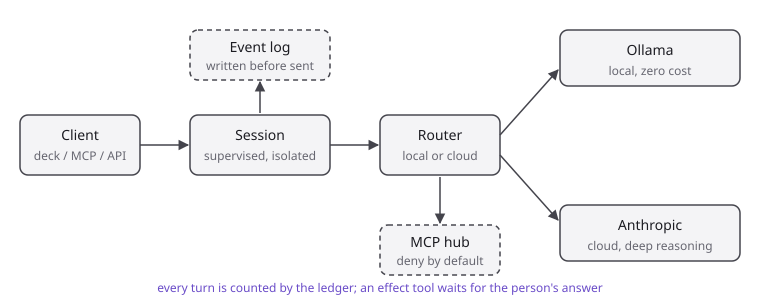

🇺🇸 [English](README.md) · 🇧🇷 [Português](README.pt.md)

# mead

[](https://github.com/albertosca/mead/actions/workflows/ci.yml) [](https://github.com/albertosca/mead/actions/workflows/lint.yml) [](https://github.com/albertosca/mead/actions/workflows/ci.yml) [](LICENSE) [](mix.exs)

Runtime for LLM-backed assistants on Elixir/OTP: supervised sessions, a local/cloud model router, and an MCP client and server.

## Quickstart

Requires Elixir 1.20+ on Erlang/OTP 29.

```
git clone https://github.com/albertosca/mead.git
cd mead
mix deps.get
mix test
```

The default turn handler echoes, so a session runs without any API key (`iex -S mix`):

```elixir
{:ok, session_id} = Mead.start_session()
Mead.submit_turn(session_id, "hello")
#=> {:ok, "hello"}
```

To route to real models, configure the router slots:

```elixir
config :mead, :turn_handler, Mead.Router

config :mead, :router,
  slots: [
    local: {Mead.Provider.Ollama, model: "llama3.1"},
    cloud: {Mead.Provider.Anthropic, model: "claude-sonnet-5-5"}
  ]
```

Persistence, the MCP hub and server, and the deck endpoint are each enabled by their own `config :mead` key. [docs/ARCHITECTURE.md](docs/ARCHITECTURE.md) lists every option.

## Overview

<picture>
  <source media="(prefers-color-scheme: dark)" srcset="assets/diagrams/turn-flow-dark.svg">
  
</picture>

- **Sessions.** One supervised process group per conversation; a failure in a turn stays in that conversation.
- **Router.** A stateless function that classifies each turn as local or cloud. `route: :local` or `route: :cloud` overrides it.
- **MCP.** A client hub for the servers you configure, and a server that exposes sessions as nine tools.
- **Ledger.** Tokens, tool calls and latency per session and per route, journaled to disk.

## Guarantees

- A local turn is never sent to the cloud; an empty local slot returns `:local_unavailable`.
- MCP tools are denied unless the policy allows them; on the deck, `:effect` tools ask the person first.
- The MCP server and the deck endpoint do not start without a bearer token.
- Nothing is persisted or trimmed unless you configure `storage` and `max_turns`.

## Design notes

| Decision | Trade-off |
|---|---|
| Deck events are written to the log before they are sent | One synced write per event; a reconnecting client replays exactly what it missed. |
| The turn clock pauses while a permission request waits | A slow answer does not time the turn out; the wait has its own limit, `permission_timeout_ms`. |
| The ledger updates ETS in the emitting process | A turn killed by timeout emits no event and is not counted. |
| History is never trimmed by default | The conversation file grows until you set `max_turns`. |

## Related projects

`agent-swarm-deck` is the Flutter client that talks to `mead` over the deck WebSocket, and `open-butler` holds the assistant's domain logic. Neither is needed to run `mead`.

## Contributing and security

See [CONTRIBUTING.md](CONTRIBUTING.md), and [SECURITY.md](SECURITY.md) to report a vulnerability privately.

## License

MIT © Alberto Cavalcanti

---

Built by Alberto Cavalcanti · [Connect on LinkedIn](https://www.linkedin.com/in/albertosca/) · [Docs](https://albertosca.github.io/mead/) · [Architecture](docs/ARCHITECTURE.md)
