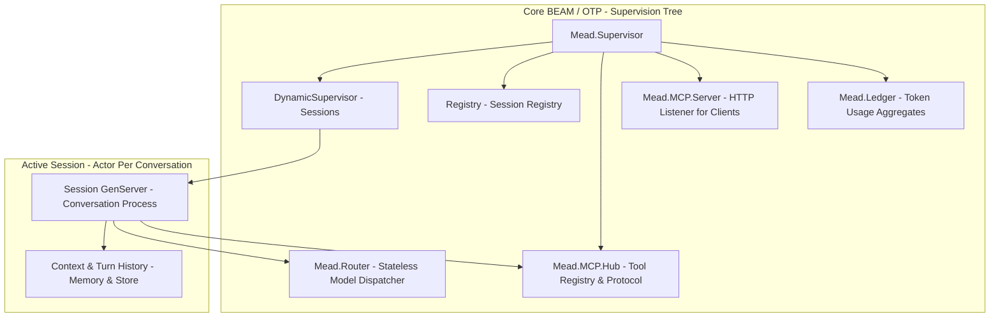
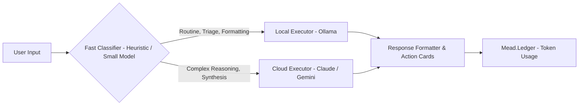

# mead Architecture Specification

**Component:** Core BEAM/OTP Runtime & Smart Router  
**Ecosystem Role:** High-concurrency engine powering AI assistant sessions  

---

## 1. High-Level Supervision Tree

### Component Details
1. **`Mead.Supervisor`:** The application root supervisor. Enforces a `rest_for_one` strategy for foundational infrastructure.
2. **`Mead.Session.Pool` (Sessions):** A `DynamicSupervisor` that starts one `Mead.Session.Supervisor` per active conversation. Each of those supervises that conversation's `Mead.Session.History` and `Mead.Session.Server`.
3. **`Registry`:** Fast in-memory process registry mapping conversation UUIDs to runtime PIDs for microsecond WebSocket routing.
4. **`Mead.Router`:** A stateless `Mead.Session.TurnHandler` with no process of its own. It classifies each turn as local or cloud (or obeys a `route:` override), calls the provider in that slot, and emits `[:mead, :router, :route]` events. It is not a child of the root supervisor, so no conversation shares a router process with another.
5. **`Mead.MCP.Hub`:** The client side of MCP. A supervisor that keeps one `Mead.MCP.Connection` per configured server and exposes `tools_for/2` and `call_tool/4`; it comes after the session pool, so a crash of the hub restarts the hub and the MCP server after it, and nothing before it.
6. **`Mead.Ledger`:** A ledger of what the router sends to providers, the first child of the root supervisor. It keeps usage aggregates per session and per route and a ring of the last 100 turns, written by a telemetry handler in the process that emitted the event, and journals them to a separate file in the storage directory so they survive a restart. Budgets and prices are not part of it.
7. **`Mead.MCP.Server`:** The server side of MCP. A supervisor, the last child of the root, that starts a `Bandit` listener running `Mead.MCP.Server.Plug` only when `config :mead, :mcp_server` has a token. Clients such as the deck use it to start sessions, submit turns, read the history, stop, resume, delete, list, and compact sessions as eight MCP tools.

8. **`Mead.Deck.ChannelSupervisor`, `Mead.Deck.Tickets`:** The deck transport (section 9): a `DynamicSupervisor` with one `Mead.Deck.Channel` per session that has a deck attached, and the table of single-use WebSocket tickets. The shared listener started by `Mead.MCP.Server` serves the deck too.

Implemented so far: the registry, the turn supervisor, the session pool, the router core with the Anthropic provider, the ledger, and both sides of MCP: the hub (client) and the HTTP server. The Ollama provider fills the local slot with text and tools, and session persistence writes each conversation to disk so it can be resumed.

---

## 2. Hybrid Model Scheduler Flow

* **Local Executor:** Handles zero-cost tasks with full privacy (command parsing, email categorization, status checks). It is an Ollama model, chosen by the operator with the required `:model` option, and it may call MCP tools under the same policy as the cloud executor; a model without tool support fails the turn with `:tools_unsupported`.
* **Cloud Executor:** Handles complex multi-step reasoning, ambiguous disambiguation, and creative synthesis.
* **Turn Handler:** Returns the model's text and usage to the session. The deck does not receive structured cards: `Mead.Deck.Channel` turns each finished turn into typed events (`text.delta`, `metric.updated`), see section 9.

---

## 3. Session Internals

Each conversation is a `Mead.Session.Supervisor` started by `Mead.Session.Pool`. It supervises two processes with a `rest_for_one` strategy: `Mead.Session.History`, an agent holding the turns, and `Mead.Session.Server`, which orchestrates them. Because the history starts first, a crashed server restarts with the same session id and the same history, and a turn that was running is marked `interrupted`. A server that crashes more than three times in five seconds takes its whole pair down and that conversation is gone; neighbouring conversations are never affected.

A turn runs in a task under `Mead.TurnSupervisor`, linked to the server, which traps exits. A handler that raises, exits, returns garbage, or exceeds the turn timeout fails only that turn (`failed` or `timeout`), and a server death takes its running task with it. The full design is in `docs/superpowers/specs/2026-10-17-session-skeleton-design.md`.

## 4. Router Internals

`Mead.Router.route/4` takes the forced route or asks `Mead.Router.Classifier`, which is a pure function that sends a turn to the local model only when the input is short, the history is light, and it asks for triage or formatting without asking for reasoning; any doubt goes to the cloud. The route names a slot holding a `{provider, options}` pair implementing `Mead.Provider`. A turn routed to an empty slot fails with `:local_unavailable` or `:cloud_unavailable` and is never sent to the other slot. Only completed text turns are replayed to the provider as history. A failed turn replies `{:error, {:failed, reason}}`. The full design is in `docs/superpowers/specs/2026-10-17-model-router-design.md`.

## 5. Ledger Internals

`Mead.Session.Server` adds `session_id` to the options it passes to the handler, and `Mead.Router` puts it in the metadata of `[:mead, :router, :route]`. `Mead.Ledger` owns two public ETS tables and attaches a `:telemetry` handler that validates each event and updates counter rows atomically with `:ets.update_counter`, in the process that emitted the event; an event it cannot read is counted as `dropped` and the handler never raises, because `:telemetry` detaches a handler that does. Totals are kept per session and per `{route, provider}`, and the last 100 turns sit in a ring. A turn that is killed by the turn timeout, or whose provider raises, emits no event and so is not counted; its `timeout` or `failed` status is only in the session history. `Mead.stop_session/1` keeps the session row, so a resumed conversation returns with what it already spent; `Mead.delete_session/1` forgets the row while the route totals keep what it added. With a storage directory the ledger also appends every counted turn, every forget and every dropped event to `ledger.journal` (the record framing of the session files, in `Mead.Session.Record`), in batches of 100 events or 50 ms written by the ledger process so a turn never waits for the disk; at boot it replays the journal before attaching the handler, a torn tail is cut with a warning and a damaged file is set aside as `ledger.journal.corrupt`. When the file passes `ledger_journal_max_bytes` (default 1 MiB) it is rewritten as one checkpoint built from the journal itself, never from the live tables, so no event is counted twice. The ledger is the first root child so that a crash of the ledger itself restores its numbers from the journal instead of wiping them. The full design is in `docs/superpowers/specs/2026-10-18-token-ledger-design.md`, and the journal in `docs/superpowers/specs/2026-10-25-ledger-persistence-design.md`, and its read side in `docs/superpowers/specs/2026-10-25-usage-tool-design.md`. The accessors read the tables from `:persistent_term`, so a ledger that is stuck on the disk does not block them.

## 6. MCP Hub Internals

`config :mead, :mcp, servers: [...]` lists the MCP servers, each with a transport (`{:stdio, command:, arguments:}` or `{:http, url:, headers:}`) and the tools the operator allows, each with a class declared in the configuration: `:read` or `:effect`. `Mead.MCP.Configuration` validates it when the application starts and refuses a typo instead of silently granting or denying the wrong tool. The class is never read from the server: a tool the server offers and the configuration does not list does not exist for the model, whatever the server says about itself.

`Mead.MCP.Connection` is one process per server. It owns a transport (`Mead.MCP.Transport.Stdio` runs a child process over a `Port`; `Mead.MCP.Transport.Http` posts each message with `Req` and reads a JSON or event-stream answer), performs the handshake with the pinned protocol version, follows the tool list across pages, publishes the tools in `Mead.MCP.Catalog`, and refreshes them on a `tools/list_changed` notification. A transport that cannot start, closes, or dies does not crash the connection: it removes its tools, fails its pending callers with `:connection_lost`, and retries after 1, 2, 5, 15, then 30 seconds, so a missing command cannot become a restart loop that takes the application down. A refresh the server never answers is abandoned after the handshake timeout and reconnects. What a server says about a tool is bounded before the model sees it: descriptions are cut at 2 000 characters, and a schema that is not an object or is over 20 000 bytes becomes the permissive default. An HTTP response over 4 MiB fails its request with `:response_too_large`, and the configuration refuses a tool whose `server__tool` name the model could never be shown. Stopping a stdio transport closes the child's stdin and then signals the child, because closing the port alone does not end it.

`Mead.MCP.Policy` decides what the model sees: `:read` tools always, `:effect` tools only when the turn passes `tools: :effect`, and anything else exactly as the default. The model sees a tool as `server__tool`; `call_tool/4` authorizes the name again before any server is contacted, so a tool the model was not shown cannot run. A result longer than 50 000 characters is truncated with a marker, and non-text content becomes a placeholder.

When the provider of the chosen slot implements `converse/3`, on either route, and the policy shows at least one tool, `Mead.Router` runs a loop of up to eight provider calls through the optional `Mead.Provider.converse/3`: tool errors, denials, and unknown tools go back to the model as error results and never fail the turn. The route event carries the sum of the tokens of every call and a `tool_calls` count. The whole loop runs inside the turn timeout, so a conversation that uses tools may need a `:turn_timeout` above the default of 30 seconds. The HTTP transport has been exercised only against a test double, not a real remote server. The full design is in `docs/superpowers/specs/2026-10-22-mcp-hub-design.md`.

## 7. MCP Server Internals

`config :mead, :mcp_server, token: "...", port: 4040, address: {127, 0, 0, 1}, allow_effect: false, allowed_origins: [], maximum_connections: 250` turns the server on. Without a `token` nothing listens and one info line says so; an invalid setting stops the application at boot with a message that never contains the token. `Mead.MCP.Server.Configuration` validates it and keeps only a SHA-256 digest of the token, which its `Inspect` hides.

The endpoint is `POST /mcp` (MCP Streamable HTTP, protocol version 2025-06-18), stateless: no `mcp-session-id` is assigned, `GET /mcp` is 405, a notification is 202, and every other message gets one JSON object. `Mead.MCP.Server.Plug` runs its checks in a fixed order and answers the first failure: route (404, 405), bearer token (401, constant time, before the body is read), `Origin` when present (loopback or listed in `allowed_origins`, else 403, the DNS rebinding protection), content type (415), body of at most 1 MiB (413), then decoding (400; a batch is refused). A bug in the dispatcher becomes a generic 500 whose log line names only the exception module, because a crash report can print the `Authorization` header.

`Mead.MCP.Server.Dispatcher` is pure: it answers `initialize`, `ping`, `tools/list`, and `tools/call`, with `-32601` for an unknown method and `-32602` for params of the wrong type. `Mead.MCP.Server.Tools` offers `start_session`, `submit_turn`, `history`, `stop_session`, `resume_session`, `delete_session`, `list_sessions`, `compact_session`, and `usage`, and calls only the public `Mead` API. `usage` reads the ledger through `Mead.usage/1` and `Mead.session_usage/2`: the totals over every route with the dropped count, the totals per route and provider, and the latest 0 to 100 turns (20 by default), or the totals of one session (the three parts are separate reads, not one snapshot, so a turn counted meanwhile may show in only some of them); providers are shown as module names and times as ISO 8601, and a ledger that is not running is an error result. A tool that fails while running (an unknown session, a failed turn, a timeout) is a result with `isError: true` and a fixed message, never a stack trace or provider text. `submit_turn` holds the request until the turn ends, bounded by the session's `turn_timeout`, which a client may set to at most one hour in `start_session`; a client that disconnects does not abort the turn. `tools: "effect"` is honoured only when the operator set `allow_effect: true`; otherwise nothing runs. The listener serves at most `maximum_connections` connections at once (rounded up to a multiple of 10 from 10 on) and closes one that finds no room after about a second, and the session pool refuses a session beyond `config :mead, :maximum_sessions` (default 1000) with `{:error, :max_children}`, which `start_session` reports as "the session could not be started". The root supervisor tolerates 10 restarts in 5 seconds.

Not part of this slice: WebSocket or SSE and any progress events, TLS, several tokens or roles, relaying the hub's own tools, `resources` and `prompts`, and IPv6 addresses. The 100 000 character input limit and the 1 MiB body limit are first values, not measured.

## 8. Persistence Internals

With `config :mead, :storage, directory: "..."` every session writes its turns through `Mead.Session.Store`, a plain module that is the only code touching the files. A session is one append-only file named after its id, a sequence of records `[4-byte length][4-byte CRC32 of the length][4-byte CRC32 of the payload][term_to_binary payload]`, each the encoding of one event: `{:append, turn}` when a turn starts, `{:replace_last, turn}` when the newest turn is closed, and `:interrupt` when turns still running became interrupted. Replaying the events rebuilds the list the history agent held. Without the setting nothing is written and `Mead.resume_session/2` answers `{:error, :not_found}`.

`Mead.Session.History` keeps the directory in its state. Only `append/2` is write-first: a turn that cannot be recorded is refused with `{:error, {:persistence, reason}}` before the handler starts and memory is left untouched. `update_last/2` and `mark_interrupted/1` always change memory and then try to write, because the caller already holds the answer; a failed write there is logged once and the reply is unchanged. A closed turn that never reached the disk comes back after a restart as an interrupted turn.

A record that is cut short or fails its payload checksum at the end of the file is what a crash during a write leaves, so it is dropped with a warning and `Mead.resume_session/2` cuts it off the file before the session writes again; the length has a checksum of its own, so a damaged header is never mistaken for a cut write. Damage anywhere else is `{:error, :corrupt_history}`, because a conversation with a hole in the middle is worse than none. Payloads are decoded without `:safe` so that a conversation holding a failed turn (an exception or atom from a module a fresh node has not loaded) can be resumed; the files are private (mode 0600), checksummed, and the directory must be trusted and single-writer. A session id becomes a file name only if it has the shape `Mead.UUID.generate/0` produces.

`Mead.resume_session/2` takes the options of `start_session/1` (the handler and the timeout are not stored), loads the file, and starts the pair with the stored turns; the server then marks the turns that were running as interrupted and records that. `Mead.stop_session/1` keeps the file, and `Mead.delete_session/1` removes it and the ledger aggregate. A write that fails is rolled back to the size the file had before it, and resuming and deleting the same id are serialised with a lock. Known limits: the file still grows with the number of turns (compaction only halves it), the rollback itself can fail on a dying disk, and the ledger is journaled in its own file, not in the session files. The full design is in `docs/superpowers/specs/2026-10-24-persistence-design.md`.

`Mead.list_sessions/0` lists the stored conversations newest first, each with its `:session_id`, the `:updated_at` of its file, and whether it `:running`. `Mead.Session.Store.list/1` reads only file names and times, never content, so its cost does not grow with the length of the conversations and a damaged file is listed like any other (it fails at resume). `Mead.Session.Pool.stop_session/1` returns only once the registry has released the id, so a stop followed at once by a resume or start of the same id cannot find the old entry.

Every turn leaves two records, `{:append, turn}` when it starts and `{:replace_last, turn}` when it closes, so a file is about twice the size it needs. `Mead.Session.Store.compact/3` rewrites it as one `{:append, turn}` per turn into `<id>.log.tmp` (mode `0600`), syncs it, and renames it over the log; `Store.load/2` returns the same turns before and after, a crash leaves the old file or the new one, and a file that would not shrink is left alone. Compaction runs at three points: at `resume_session/2`, inside `History` once a live file reaches `compact_after_bytes` (default 1 MiB, under `config :mead, :storage`) and is also at least 1.5 times its size after the last compaction, which keeps the rewrite from happening on every turn, and on request through `Mead.compact_session/1` or the `compact_session` MCP tool. A failed compaction only logs a warning and never fails a turn, a resume or a stop. A resume marks the turns that were running as interrupted before it compacts, so a file that shrinks is already canonical after one resume; one with nothing to remove is left alone and the history writes the interrupt marker as before. The full design is in `docs/superpowers/specs/2026-10-25-compaction-design.md`.

## 9. Deck Transport Internals

`config :mead, :deck, token: "...", ticket_ttl_ms: 10_000, permission_timeout_ms: 120_000, heartbeat_ms: 15_000, resume_deadline_ms: 10_000, queue_limit: 10, default_policy_level: :ask_for_risky` turns the deck on; the token is a secret separate from the MCP token, and without it no deck route exists. The deck shares the one `Bandit` listener of `Mead.MCP.Server` (port, address, `allowed_origins` and connection limit come from `:mcp_server`), which starts when either token is set, behind `Mead.Gateway`: the first path segment `deck` goes to `Mead.Deck.Plug`, everything else to the MCP plug.

`POST /deck/ticket` takes the deck bearer token (checked in constant time before the body is read) and an optional `{"session_id": "<uuid>"}`: no id starts a session with `Mead.Router` as handler, a running id is reused, a stopped id with a stored history is resumed, anything else is 404. The answer is `{"ticket", "session_id", "expires_in_ms"}`. `GET /deck/socket?ticket=...` redeems the ticket (an atomic ETS take, so two attempts with one ticket upgrade at most one) and upgrades to a WebSocket served by `Mead.Deck.Socket`; a request that is not a valid upgrade is refused with 426 before the ticket is touched, and the `Origin` rule is the same as MCP's (`Mead.Origin`). The socket's first message must be `session.resume {last_sequence}` within `resume_deadline_ms`; it answers with an unsequenced `session.snapshot` and replays every sequenced event after `last_sequence` from the log.

`Mead.Deck.Channel` is the state: one process per session that owns the event sequence, the prompt queue and the running turn, so a reconnect or a second device finds the same state. Every sequenced event is appended to `<id>.events` (`Mead.Deck.EventLog`, mode 0600, one record per event on the session file framing, a torn tail cut on open) before anyone is sent it, and a log that cannot be written stops the channel. `prompt.send` is idempotent on `client_message_id`, prompts wait behind at most `queue_limit` others, and each turn runs through `Mead.submit_turn/3` with `route: :auto, tools: :effect`. `stop_session/1` keeps the event log, `delete_session/1` removes it.

Permissions: each deck turn carries `Mead.Deck.Interaction`, so `Mead.Router` asks the channel before every tool call (`Mead.Router.Interaction`; a turn without one keeps the old path, and a denied call never reaches `Mead.MCP.Hub`). The tool's class decides the risk: `:read` is low and `:effect` is high. The policy level (`ask_always`, `ask_for_risky`, `allow_all`; the last `policy.updated` in the log, else `default_policy_level`) decides what happens: `allow_all` emits `permission.requested` and at once `permission.resolved` with `decided_by_policy`, `ask_for_risky` runs a `:read` call silently, and anything else emits `permission.requested` and waits. While it waits the turn clock is paused (`Mead.Session.Server.pause_clock/1`), the first valid `permission.respond` wins (`allow_once` or `reject_once`, `decided_by_device` is `device-<n>`, numbered per channel as sockets resume), a later answer gets the existing `permission.resolved` again on that socket alone, and `permission_timeout_ms` resolves it as `expired`. A request whose asker died expires too, and a channel that starts with an unresolved request in its log expires it before serving anyone. Request details are the model's arguments cut at 2 000 characters each and are never logged.

A client frame that is binary, over 64 KiB, not JSON, not an object, of an unknown type or with an invalid payload is ignored and logged by reason only; more than 20 in a minute close the socket (1008). The transport itself bounds a frame at 1 MiB and closes the connection (1009) above that. A heartbeat goes out every `heartbeat_ms` whatever a turn is doing, and the socket has no idle timeout.
