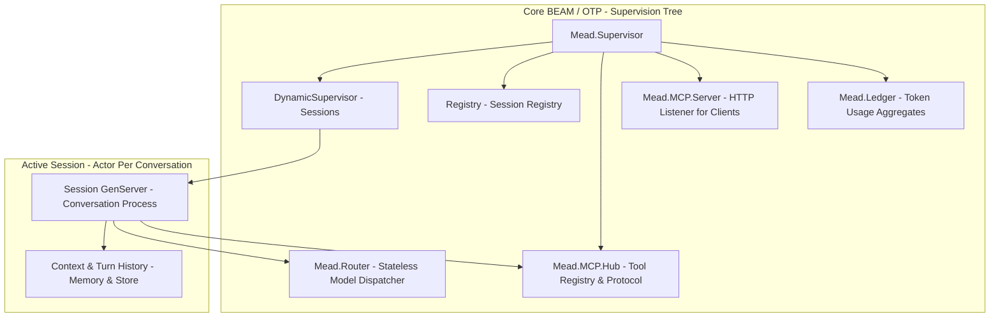
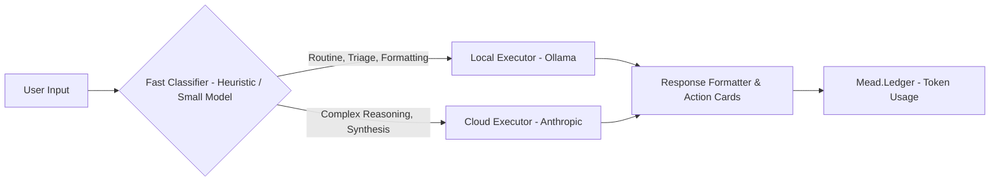

# mead Architecture Specification

**Component:** Core BEAM/OTP Runtime & Smart Router  
**Ecosystem Role:** High-concurrency engine powering AI assistant sessions  

---

## 1. High-Level Supervision Tree



### Component Details
1. **`Mead.Supervisor`:** The application root supervisor. Enforces a `rest_for_one` strategy for foundational infrastructure.
2. **`Mead.Session.Pool` (Sessions):** A `DynamicSupervisor` that starts one `Mead.Session.Supervisor` per active conversation. Each of those supervises that conversation's `Mead.Session.History` and `Mead.Session.Server`.
3. **`Registry`:** Fast in-memory process registry mapping conversation UUIDs to runtime PIDs for microsecond WebSocket routing.
4. **`Mead.Router`:** A stateless `Mead.Session.TurnHandler` with no process of its own. It classifies each turn as local or cloud (or obeys a `route:` override), calls the provider in that slot, and emits `[:mead, :router, :route]` events. It is not a child of the root supervisor, so no conversation shares a router process with another.
5. **`Mead.MCP.Hub`:** The client side of MCP. A supervisor that keeps one `Mead.MCP.Connection` per configured server and exposes `tools_for/2` and `call_tool/4`; it comes after the session pool, so a crash of the hub restarts the hub and the MCP server after it, and nothing before it.
6. **`Mead.Ledger`:** A ledger of what the router sends to providers, the first child of the root supervisor. It keeps usage aggregates per session and per route and a ring of the last 100 turns, written by a telemetry handler in the process that emitted the event, and journals them to a separate file in the storage directory so they survive a restart. Budgets and prices are not part of it.
7. **`Mead.MCP.Server`:** The server side of MCP. A supervisor, the last child of the root, that starts a `Bandit` listener running `Mead.MCP.Server.Plug` only when `config :mead, :mcp_server` has a token. Clients such as the deck use it to start sessions, submit turns, read the history, stop, resume, delete, list, and compact sessions as nine MCP tools.

8. **`Mead.Deck.ChannelSupervisor`, `Mead.Deck.Tickets`:** The deck transport (section 9): a `DynamicSupervisor` with one `Mead.Deck.Channel` per session that has a deck attached, and the table of single-use WebSocket tickets. The shared listener started by `Mead.MCP.Server` serves the deck too.

Implemented so far: the registry, the turn supervisor, the session pool, the router core with the Anthropic provider, the ledger, and both sides of MCP: the hub (client) and the HTTP server. The Ollama provider fills the local slot with text and tools, and session persistence writes each conversation to disk so it can be resumed.

---

## 2. Hybrid Model Scheduler Flow



* **Local Executor:** Handles zero-cost tasks with full privacy (command parsing, email categorization, status checks). It is an Ollama model, chosen by the operator with the required `:model` option, and it may call MCP tools under the same policy as the cloud executor; a model without tool support fails the turn with `:tools_unsupported`. The first request after Ollama unloaded the model pays the load (28 s for a 2 GB model in a real run), longer than the default 25 s `:receive_timeout`, so a deployment sets the optional `:keep_alive` (sent to Ollama as is) and raises `:receive_timeout` together with the turn timeout.
* **Cloud Executor:** Handles complex multi-step reasoning, ambiguous disambiguation, and creative synthesis.
* **Turn Handler:** Returns the model's text and usage to the session. The deck does not receive structured cards: `Mead.Deck.Channel` turns each finished turn into typed events (`text.delta` as the answer streams, `metric.updated` when it ends), see section 9.

---

## 3. Session Internals

### Structure

Each conversation is a `Mead.Session.Supervisor` started by `Mead.Session.Pool`. It supervises two processes with a `rest_for_one` strategy:

* `Mead.Session.History`: an agent that holds the turns.
* `Mead.Session.Server`: orchestrates the conversation.

### Failure handling

* The history starts first, so a crashed server restarts with the same session id and the same history. A turn that was running is marked `interrupted`.
* A server that crashes more than three times in five seconds takes its whole pair down, and that conversation is gone. Neighbouring conversations are never affected.
* A turn runs in a task under `Mead.TurnSupervisor`, linked to the server, which traps exits.
* A handler that raises, exits, returns garbage, or exceeds the turn timeout fails only that turn, with the status `failed` or `timeout`.
* A server death takes its running task with it.

## 4. Router Internals

### Choosing the slot

`Mead.Router.route/4` takes the forced route, or asks `Mead.Router.Classifier`. The classifier is a pure function. It sends a turn to the local model only when all three hold:

* the input is short;
* the history is light;
* the turn asks for triage or formatting without asking for reasoning.

Any doubt goes to the cloud.

### Slots and providers

The route names a slot, and a slot holds a `{provider, options}` pair that implements `Mead.Provider`.

* A turn routed to an empty slot fails with `:local_unavailable` or `:cloud_unavailable`. It is never sent to the other slot.
* Only completed text turns are replayed to the provider as history.
* A failed turn replies `{:error, {:failed, reason}}`.

### Streaming

A provider may also export `converse_stream/4`.

* Anthropic reads server-sent events through `Mead.Provider.ServerSentEvents`. Ollama reads one JSON object per line.
* Both fold the stream into the body a plain call returns and parse it the same way, so a streamed turn and a plain turn give the same result.
* When the turn has an interaction and the provider can stream, the router passes it a callback that reaches `text_delta/2`. The text of every model call in a tool loop is then streamed.
* The turn's output is the text of every call joined with a blank line. That is also the separator the stream carries, so a replay shows what the live view showed.

## 5. Ledger Internals

### What it records

`Mead.Session.Server` adds `session_id` to the options it passes to the handler, and `Mead.Router` puts it in the metadata of `[:mead, :router, :route]`.

`Mead.Ledger` owns two public ETS tables and attaches a `:telemetry` handler. The handler validates each event and updates counter rows atomically with `:ets.update_counter`, in the process that emitted the event.

* An event it cannot read is counted as `dropped`. The handler never raises, because `:telemetry` detaches a handler that does.
* Totals are kept per session and per `{route, provider}`. The last 100 turns sit in a ring.
* A turn killed by the turn timeout, or whose provider raises, emits no event and so is not counted. Its `timeout` or `failed` status is only in the session history.
* `Mead.stop_session/1` keeps the session row, so a resumed conversation returns with what it already spent. `Mead.delete_session/1` forgets the row, while the route totals keep what it added.
* The accessors read the tables from `:persistent_term`, so a ledger that is stuck on the disk does not block them.

### The journal

With a storage directory, the ledger also appends every counted turn, every forget and every dropped event to `ledger.journal`. The file uses the record framing of the session files (`Mead.Session.Record`).

* Writes go in batches of 100 events or 50 ms, made by the ledger process, so a turn never waits for the disk.
* At boot the ledger replays the journal before it attaches the handler. A torn tail is cut with a warning, and a damaged file is set aside as `ledger.journal.corrupt`.
* When the file passes `ledger_journal_max_bytes` (default 1 MiB), it is rewritten as one checkpoint built from the journal itself, never from the live tables, so no event is counted twice.
* The ledger is the first root child, so a crash of the ledger itself restores its numbers from the journal instead of wiping them.

## 6. MCP Hub Internals

### Configuration

`config :mead, :mcp, servers: [...]` lists the MCP servers. Each entry has:

* a transport: `{:stdio, command:, arguments:}` or `{:http, url:, headers:}`;
* the tools the operator allows, each with a class declared in the configuration: `:read` or `:effect`.

`Mead.MCP.Configuration` validates it when the application starts and refuses a typo instead of silently granting or denying the wrong tool.

The class is never read from the server. A tool the server offers and the configuration does not list does not exist for the model, whatever the server says about itself.

### Connections

`Mead.MCP.Connection` is one process per server. It owns a transport:

* `Mead.MCP.Transport.Stdio` runs a child process over a `Port`.
* `Mead.MCP.Transport.Http` posts each message with `Req` and reads a JSON or event-stream answer.

The connection performs the handshake with the pinned protocol version, follows the tool list across pages, publishes the tools in `Mead.MCP.Catalog`, and refreshes them on a `tools/list_changed` notification.

**When something goes wrong**

* A transport that cannot start, closes, or dies does not crash the connection. It removes its tools, fails its pending callers with `:connection_lost`, and retries after 1, 2, 5, 15, then 30 seconds. A missing command therefore cannot become a restart loop that takes the application down.
* When a call's caller dies or its timer runs out, the connection sends `notifications/cancelled` with the request id so the server can stop the work. The server may ignore it, and a late answer is dropped.
* A refresh the server never answers is abandoned after the handshake timeout, and the connection reconnects.
* Stopping a stdio transport closes the child's stdin and then signals the child, because closing the port alone does not end it.

**Bounds on what a server says**

* Descriptions are cut at 2 000 characters.
* A schema that is not an object, or is over 20 000 bytes, becomes the permissive default.
* An HTTP response over 4 MiB fails its request with `:response_too_large`.
* The configuration refuses a tool whose `server__tool` name the model could never be shown.

### Policy

`Mead.MCP.Policy` decides what the model sees:

* `:read` tools are always shown.
* `:effect` tools are shown only when the turn passes `tools: :effect`.
* Anything else is exactly the default.

The model sees a tool as `server__tool`. `call_tool/4` authorizes the name again before any server is contacted, so a tool the model was not shown cannot run.

A result longer than 50 000 characters is truncated with a marker, and non-text content becomes a placeholder.

### The tool loop

When the provider of the chosen slot implements `converse/3` (on either route) and the policy shows at least one tool, `Mead.Router` runs a loop of up to eight provider calls through the optional callback `c:Mead.Provider.converse/3`.

* Tool errors, denials, and unknown tools go back to the model as error results. They never fail the turn.
* The route event carries the sum of the tokens of every call and a `tool_calls` count.
* The whole loop runs inside the turn timeout, so a conversation that uses tools may need a `:turn_timeout` above the default of 30 seconds.

**Known limit:** the HTTP transport has been exercised only against a test double, not a real remote server.

## 7. MCP Server Internals

### Turning it on

```elixir
config :mead, :mcp_server,
  token: "...",
  port: 4040,
  address: {127, 0, 0, 1},
  allow_effect: false,
  allowed_origins: [],
  maximum_connections: 250
```

* Without a `token`, nothing listens and one info line says so.
* An invalid setting stops the application at boot, with a message that never contains the token.
* Adding `certfile: "cert.pem", keyfile: "key.pem"` (both or neither) makes the one listener speak HTTPS, and WSS for the deck. No plain-HTTP port is left open.
* `Mead.MCP.Server.Configuration` validates the settings and keeps only a SHA-256 digest of the token, which its `Inspect` hides.

### The endpoint

The endpoint is `POST /mcp` (MCP Streamable HTTP, protocol version 2025-06-18). It is stateless: no `mcp-session-id` is assigned, `GET /mcp` is 405, a notification is 202, and every other message gets one JSON object.

`Mead.MCP.Server.Plug` runs its checks in a fixed order and answers the first failure:

| Order | Check | Failure |
|---|---|---|
| 1 | Route | 404, 405 |
| 2 | Bearer token (constant time, before the body is read) | 401 |
| 3 | `Origin`, when present: loopback or listed in `allowed_origins` (DNS rebinding protection) | 403 |
| 4 | Content type | 415 |
| 5 | Body of at most 1 MiB | 413 |
| 6 | Decoding (a batch is refused) | 400 |

A bug in the dispatcher becomes a generic 500. Its log line names only the exception module, because a crash report can print the `Authorization` header.

### The dispatcher and the tools

`Mead.MCP.Server.Dispatcher` is pure. It answers `initialize`, `ping`, `tools/list`, and `tools/call`, with `-32601` for an unknown method and `-32602` for params of the wrong type.

`Mead.MCP.Server.Tools` offers nine tools and calls only the public `Mead` API:

* `start_session`, `submit_turn`, `history`
* `stop_session`, `resume_session`, `delete_session`
* `list_sessions`, `compact_session`, `usage`

**Details**

* `usage` reads the ledger through `Mead.usage/1` and `Mead.session_usage/2`. It returns the totals over every route with the dropped count, the totals per route and provider, and the latest 0 to 100 turns (20 by default), or the totals of one session. The three parts are separate reads, not one snapshot, so a turn counted meanwhile may show in only some of them. Providers are shown as module names and times as ISO 8601. A ledger that is not running is an error result.
* A tool that fails while running (an unknown session, a failed turn, a timeout) is a result with `isError: true` and a fixed message, never a stack trace or provider text.
* `submit_turn` holds the request until the turn ends, bounded by the session's `turn_timeout`, which a client may set to at most one hour in `start_session`. A client that disconnects does not abort the turn.
* `tools: "effect"` is honoured only when the operator set `allow_effect: true`. Otherwise nothing runs.

### Limits

* The listener serves at most `maximum_connections` connections at once (rounded up to a multiple of 10 from 10 on). It closes one that finds no room after about a second.
* The session pool refuses a session beyond `config :mead, :maximum_sessions` (default 1000) with `{:error, :max_children}`, which `start_session` reports as "the session could not be started".
* The root supervisor tolerates 10 restarts in 5 seconds.

### Not in this slice

* SSE and progress events, several tokens or roles, relaying the hub's own tools, `resources` and `prompts`, and IPv6 addresses. (The deck's WebSocket and TLS are described in section 9.)
* The 100 000 character input limit and the 1 MiB body limit are first values, not measured.

## 8. Persistence Internals

### The files

With `config :mead, :storage, directory: "..."`, every session writes its turns through `Mead.Session.Store`. It is a plain module and the only code that touches the files.

A session is one append-only file named after its id. Each record has this layout:

```
[4-byte length][4-byte CRC32 of the length][4-byte CRC32 of the payload][term_to_binary payload]
```

Each record is the encoding of one event:

* `{:append, turn}` when a turn starts;
* `{:replace_last, turn}` when the newest turn is closed;
* `:interrupt` when turns still running became interrupted.

Replaying the events rebuilds the list the history agent held. Without the setting nothing is written, and `Mead.resume_session/2` answers `{:error, :not_found}`.

### Writing

`Mead.Session.History` keeps the directory in its state.

* Only `append/2` is write-first. A turn that cannot be recorded is refused with `{:error, {:persistence, reason}}` before the handler starts, and memory is left untouched.
* `update_last/2` and `mark_interrupted/1` always change memory and then try to write, because the caller already holds the answer. A failed write there is logged once and the reply is unchanged.
* A closed turn that never reached the disk comes back after a restart as an interrupted turn.
* A write that fails is rolled back to the size the file had before it.
* Resuming and deleting the same id are serialised with a lock.

### Reading and damage

* A record that is cut short, or fails its payload checksum, at the end of the file is what a crash during a write leaves. It is dropped with a warning, and `Mead.resume_session/2` cuts it off the file before the session writes again.
* The length has a checksum of its own, so a damaged header is never mistaken for a cut write.
* Damage anywhere else is `{:error, :corrupt_history}`, because a conversation with a hole in the middle is worse than none.
* Payloads are decoded without `:safe`, so that a conversation holding a failed turn (an exception or atom from a module a fresh node has not loaded) can be resumed. The files are private (mode 0600) and checksummed, and the directory must be trusted and single-writer.
* A session id becomes a file name only if it has the shape `Mead.UUID.generate/0` produces.

### Resume, stop and delete

* `Mead.resume_session/2` takes the options of `start_session/1` (the handler and the timeout are not stored), loads the file, and starts the pair with the stored turns. The server then marks the turns that were running as interrupted and records that.
* `Mead.stop_session/1` keeps the file.
* `Mead.delete_session/1` removes the file and the ledger aggregate.
* `Mead.Session.Pool.stop_session/1` returns only once the registry has released the id, so a stop followed at once by a resume or start of the same id cannot find the old entry.

### Listing

`Mead.list_sessions/0` lists the stored conversations newest first. Each entry has its `:session_id`, the `:updated_at` of its file, and whether it is `:running`.

`Mead.Session.Store.list/1` reads only file names and times, never content. Its cost does not grow with the length of the conversations, and a damaged file is listed like any other (it fails at resume).

### Compaction

Every turn leaves two records, `{:append, turn}` when it starts and `{:replace_last, turn}` when it closes, so a file is about twice the size it needs.

`Mead.Session.Store.compact/3` rewrites it as one `{:append, turn}` per turn:

1. It writes `<id>.log.tmp` (mode `0600`).
2. It syncs the file.
3. It renames it over the log.

`Store.load/2` returns the same turns before and after, a crash leaves the old file or the new one, and a file that would not shrink is left alone.

Compaction runs at three points:

* at `resume_session/2`;
* inside `History`, once a live file reaches `compact_after_bytes` (default 1 MiB, under `config :mead, :storage`) and is also at least 1.5 times its size after the last compaction, which keeps the rewrite from happening on every turn;
* on request, through `Mead.compact_session/1` or the `compact_session` MCP tool.

A failed compaction only logs a warning. It never fails a turn, a resume or a stop.

A resume marks the turns that were running as interrupted before it compacts, so a file that shrinks is already canonical after one resume. One with nothing to remove is left alone, and the history writes the interrupt marker as before.

### Trimming old turns

Compaction keeps every turn unless `config :mead, :storage, max_turns: N` is set. Then the live compaction, the compaction at resume and `compact_session/1` keep only the newest N turns, in memory and in the file, and the older ones are gone. It is off by default, because it is the one setting that deletes conversation.

### Known limits

* The file still grows with the number of turns (compaction only halves it).
* The rollback itself can fail on a dying disk.
* The ledger is journaled in its own file, not in the session files.

## 9. Deck Transport Internals

### Turning it on

```elixir
config :mead, :deck,
  token: "...",
  ticket_ttl_ms: 10_000,
  permission_timeout_ms: 120_000,
  heartbeat_ms: 15_000,
  idle_timeout_ms: 90_000,
  resume_deadline_ms: 10_000,
  queue_limit: 10,
  event_log_limit: 10_000,
  default_policy_level: :ask_for_risky
```

* The token is a secret separate from the MCP token. Without it, no deck route exists.
* The deck shares the one `Bandit` listener of `Mead.MCP.Server`. Port, address, `allowed_origins` and the connection limit come from `:mcp_server`. The listener starts when either token is set.
* `Mead.Gateway` sits in front: the first path segment `deck` goes to `Mead.Deck.Plug`, and everything else goes to the MCP plug.

### Connecting

1. **Ticket.** `POST /deck/ticket` takes the deck bearer token (checked in constant time before the body is read) and an optional `{"session_id": "<uuid>"}`.
   * No id starts a session with `Mead.Router` as handler.
   * A running id is reused.
   * A stopped id with a stored history is resumed.
   * Anything else is 404.
   * The answer is `{"ticket", "session_id", "expires_in_ms"}`.
2. **Socket.** `GET /deck/socket?ticket=...` redeems the ticket and upgrades to a WebSocket served by `Mead.Deck.Socket`.
   * Redeeming is an atomic ETS take, so two attempts with one ticket upgrade at most one.
   * A request that is not a valid upgrade is refused with 426 before the ticket is touched.
   * The `Origin` rule is the same as MCP's (`Mead.Origin`).
3. **Resume.** The socket's first message must be `session.resume {last_sequence}` within `resume_deadline_ms`. The server answers with an unsequenced `session.snapshot` and replays every sequenced event after `last_sequence` from the log.

### The channel and the event log

`Mead.Deck.Channel` is the state: one process per session that owns the event sequence, the prompt queue and the running turn. A reconnect or a second device therefore finds the same state.

* Every sequenced event is appended to `<id>.events` before anyone is sent it. The log is `Mead.Deck.EventLog`: mode 0600, one record per event on the session file framing, a torn tail cut on open. A log that cannot be written stops the channel.
* `prompt.send` is idempotent on `client_message_id`.
* Prompts wait behind at most `queue_limit` others.
* Each turn runs through `Mead.submit_turn/3` with `route: :auto, tools: :effect`.
* When a turn ends and nothing is queued, a log longer than `event_log_limit` is compacted. `EventLog.compact/2` keeps the newest events plus the latest `policy.updated`, rewritten through a temporary file and a rename.
* `session.snapshot` carries `first_sequence`, the lowest sequence a replay can start from, so a client resuming from an older one knows the middle is gone.
* A dropped prompt's `client_message_id` is forgotten, so a resend of that old message would be accepted again.
* `stop_session/1` keeps the event log, and `delete_session/1` removes it.

### Permissions

Each deck turn carries `Mead.Deck.Interaction`, so `Mead.Router` asks the channel before every tool call (`Mead.Router.Interaction`). A turn without one keeps the old path. A denied call never reaches `Mead.MCP.Hub`.

**Deciding**

* The tool's class decides the risk: `:read` is low and `:effect` is high.
* The policy level decides what happens. It is the last `policy.updated` in the log, else `default_policy_level`.

| Policy level | What happens |
|---|---|
| `allow_all` | Emits `permission.requested` and at once `permission.resolved` with `decided_by_policy`. |
| `ask_for_risky` | Runs a `:read` call silently. Anything else emits `permission.requested` and waits. |
| `ask_always` | Emits `permission.requested` and waits. |

**While a request waits**

* The turn clock is paused (`Mead.Session.Server.pause_clock/1`).
* The first valid `permission.respond` wins. Its answer is `allow_once`, `allow_always` or `reject_once`.
* `decided_by_device` is the optional `device_id` the client sent in `session.resume`, else `device-<n>`, numbered per channel as sockets resume.
* A later answer gets the existing `permission.resolved` again, on that socket alone.
* `permission_timeout_ms` resolves the request as `expired`.
* A request whose asker died expires too. A channel that starts with an unresolved request in its log expires it before serving anyone.

**Remembering a choice**

* `allow_always` allows the call and remembers the tool as `<server>__<tool>`. Its `permission.resolved` carries `remember`.
* The next request for that tool is allowed at once with `decided_by_rule`. Under `allow_all` it stays `decided_by_policy`.
* The rules are rebuilt from the log and kept through compaction.
* `permission.forget {tool}` takes one back with a `permission.forgotten` event.

Request details are the model's arguments cut at 2 000 characters each, and they are never logged. They travel twice in `permission.requested`: `details` as `key: value` strings, and `detail_items` as objects with the raw `key` and `value`, a `label` (the key as words) and, when the value is a snake_case identifier, a `display` (the identifier as words). A deck that only reads `details` keeps working.

### Frames, heartbeat and idle timeout

* A client frame that is binary, over 64 KiB, not JSON, not an object, of an unknown type or with an invalid payload is ignored and logged by reason only. More than 20 in a minute close the socket (1008).
* The transport itself bounds a frame at 1 MiB and closes the connection (1009) above that.
* A heartbeat goes out every `heartbeat_ms` whatever a turn is doing, followed by a WebSocket ping.
* Any frame from the client (text, ping or pong) counts as activity. A socket with none for `idle_timeout_ms` (default 90 000, must exceed `heartbeat_ms`) is closed with 1001 "idle". A client that answers pings by itself therefore never times out.

### Questions

When a turn has an interaction and at least one other tool, the router offers the model a built-in `ask_user` tool (a prompt and 2 to 6 options).

* The router answers it itself. It is never gated by the policy and never sent to the hub. MCP tool names always contain `__`, so no server can shadow it.
* The channel emits `choice.requested`, pauses the clock like a permission, and the first valid `choice.respond` wins.
* `permission_timeout_ms` resolves it with no option, and the model then reads "The person did not choose in time."
* The model may set `allow_free_text: true`. The request then carries `allow_free_text: true`, and `choice.respond` takes exactly one of `option_id` and `text` (a non-blank text of at most 4 096 bytes). A text answer to a request that did not allow it is ignored. `choice.resolved` then has `option_id: null` and the `text`, and the model reads "The person answered: ...". The text is kept in the event log, so a reconnect replays it, and is never written to the logger.
* A turn whose provider cannot be asked gets "The person could not be asked."

### Streaming and cancellation

* Each fragment a streaming provider produces becomes a sequenced `text.delta`, and a turn that streamed does not emit its final text again. A provider that cannot stream still emits its whole answer as one `text.delta`.
* A running tool call is registered with the channel (`register_call/3`), so `tool_call.cancel` can stop it. The model sees the call as failed.
* Each finished turn emits two `metric.updated` events, `tokens_in` and `tokens_out`.
* A turn that ends in an error emits `turn.failed {turn_id, reason}`. A stream cut off midway keeps its fragments and then fails. Tool cards still open at that moment are killed and closed as `failed`.
* A tool process also ends when the router that started it dies.

### Server-sent events fallback

For a client that cannot hold a WebSocket (a proxy that strips the upgrade, a platform without one), the same channel is reachable over HTTP. `GET /deck/events?ticket=T[&last_sequence=N][&device_id=D]` redeems a ticket exactly like the socket does and answers with a `text/event-stream` (`cache-control: no-store`, `x-accel-buffering: no`, `connection: close`). The resume position may also come as the `Last-Event-ID` header; the query wins, and a malformed value is a 400 that does not burn the ticket.

* The first event is `event: connected` with `{"connection_token", "session_id"}`. Every other event is unnamed: `data:` is the same envelope the WebSocket carries and `id:` is its sequence, so a reconnecting browser sends `Last-Event-ID` on its own. Heartbeats carry no `id`.
* The client sends messages with `POST /deck/messages`, `Authorization: Bearer <connection_token>` and the exact body of a WebSocket client message. The answer is 202 with an empty body, 400 with `{"error": reason}` (`session.resume` is refused with `resume_not_accepted`, because the position is chosen when the stream opens), 401, 403 for a foreign Origin, or 413 over `maximum_frame_bytes`.
* To resume, open a new stream with a new ticket and `last_sequence`. When the session stops the stream ends with `event: closed`, and so it does when the server shuts down.
* A client that vanished is noticed by a failed write, at the latest one heartbeat later; the stream then detaches from the channel synchronously (`Channel.detach/2`) and drops its connection token.
* There are no CORS headers, as everywhere else in the deck transport, so a browser must reach it from the same origin (for example through a reverse proxy).

### Recovery

Each turn ends with one `tokens_out` metric that carries its `turn_id`. A new channel uses it to find the prompts that never finished in the log.

* The first of them was running when the channel died. It is reported as `turn.failed` with reason `interrupted`, and its open tool cards are closed as `failed`.
* The ones behind it run again.

### Live test

The opt-in test `test/mead/deck/live_ollama_test.exs` (`mix test --include live`) drives the whole stack against a local `llama3.2:3b`.
