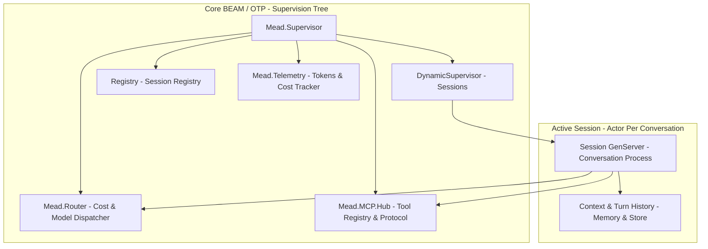
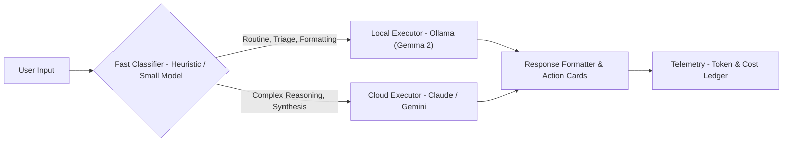

# mead Architecture Specification

**Component:** Core BEAM/OTP Runtime & Smart Router  
**Ecosystem Role:** High-concurrency engine powering AI assistant sessions  

---

## 1. High-Level Supervision Tree

### Component Details
1. **`Mead.Supervisor`:** The application root supervisor. Enforces a `rest_for_one` strategy for foundational infrastructure.
2. **`DynamicSupervisor` (Sessions):** Dynamically spawns one `Mead.Session.Server` `GenServer` per active conversation.
3. **`Registry`:** Fast in-memory process registry mapping conversation UUIDs to runtime PIDs for microsecond WebSocket routing.
4. **`Mead.Router`:** Analyzes incoming prompt characteristics and decides routing destinations (local Ollama vs. cloud models) based on latency, cost, and complexity.
5. **`Mead.MCP.Hub`:** Aggregates registered tool definitions, manages execution permissions, and translates JSON-RPC MCP messages.
6. **`Mead.Telemetry`:** Real-time token consumption ledger emitting alerts as spend thresholds approach limits.

---

## 2. Hybrid Model Scheduler Flow

* **Local Executor:** Handles zero-cost tasks with full privacy (command parsing, email categorization, status checks).
* **Cloud Executor:** Handles complex multi-step reasoning, ambiguous disambiguation, and creative synthesis.
* **Turn Handler:** Packages raw model outputs into streaming Markdown text paired with structured `ActionCard` JSON specifications for client consumption.
