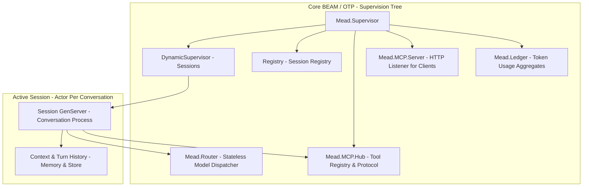
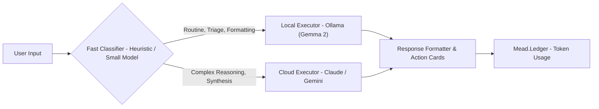

# mead Architecture Specification

**Component:** Core BEAM/OTP Runtime & Smart Router  
**Ecosystem Role:** High-concurrency engine powering AI assistant sessions  

---

## 1. High-Level Supervision Tree

### Component Details
1. **`Mead.Supervisor`:** The application root supervisor. Enforces a `rest_for_one` strategy for foundational infrastructure.
2. **`Mead.Session.Pool` (Sessions):** A `DynamicSupervisor` that starts one `Mead.Session.Supervisor` per active conversation. Each of those supervises that conversation's `Mead.Session.History` and `Mead.Session.Server`.
3. **`Registry`:** Fast in-memory process registry mapping conversation UUIDs to runtime PIDs for microsecond WebSocket routing.
4. **`Mead.Router`:** A stateless `Mead.Session.TurnHandler` with no process of its own. It classifies each turn as local or cloud (or obeys a `route:` override), calls the provider in that slot, and emits `[:mead, :router, :route]` events. It is not a child of the root supervisor, so no conversation shares a router process with another.
5. **`Mead.MCP.Hub`:** The client side of MCP. A supervisor that keeps one `Mead.MCP.Connection` per configured server and exposes `tools_for/2` and `call_tool/4`; it comes after the session pool, so a crash of the hub restarts the hub and the MCP server after it, and nothing before it.
6. **`Mead.Ledger`:** An in-memory ledger of what the router sends to providers, the first child of the root supervisor. It keeps usage aggregates per session and per route and a ring of the last 100 turns, written by a telemetry handler in the process that emitted the event. Budgets, prices, and disk persistence are not part of it.
7. **`Mead.MCP.Server`:** The server side of MCP. A supervisor, the last child of the root, that starts a `Bandit` listener running `Mead.MCP.Server.Plug` only when `config :mead, :mcp_server` has a token. Clients such as the deck use it to start sessions, submit turns, read the history, and stop sessions as four MCP tools.

Implemented so far: the registry, the turn supervisor, the session pool, the router core with the Anthropic provider, the ledger, and both sides of MCP: the hub (client) and the HTTP server. The Ollama provider is specified here and arrives in a later slice.

---

## 2. Hybrid Model Scheduler Flow

* **Local Executor:** Handles zero-cost tasks with full privacy (command parsing, email categorization, status checks).
* **Cloud Executor:** Handles complex multi-step reasoning, ambiguous disambiguation, and creative synthesis.
* **Turn Handler:** Packages raw model outputs into streaming Markdown text paired with structured `ActionCard` JSON specifications for client consumption.

---

## 3. Session Internals

Each conversation is a `Mead.Session.Supervisor` started by `Mead.Session.Pool`. It supervises two processes with a `rest_for_one` strategy: `Mead.Session.History`, an agent holding the turns, and `Mead.Session.Server`, which orchestrates them. Because the history starts first, a crashed server restarts with the same session id and the same history, and a turn that was running is marked `interrupted`. A server that crashes more than three times in five seconds takes its whole pair down and that conversation is gone; neighbouring conversations are never affected.

A turn runs in a task under `Mead.TurnSupervisor`, linked to the server, which traps exits. A handler that raises, exits, returns garbage, or exceeds the turn timeout fails only that turn (`failed` or `timeout`), and a server death takes its running task with it. The full design is in `docs/superpowers/specs/2026-10-17-session-skeleton-design.md`.

## 4. Router Internals

`Mead.Router.route/4` takes the forced route or asks `Mead.Router.Classifier`, which is a pure function that sends a turn to the local model only when the input is short, the history is light, and it asks for triage or formatting without asking for reasoning; any doubt goes to the cloud. The route names a slot holding a `{provider, options}` pair implementing `Mead.Provider`. A turn routed to an empty slot fails with `:local_unavailable` or `:cloud_unavailable` and is never sent to the other slot. Only completed text turns are replayed to the provider as history. A failed turn replies `{:error, {:failed, reason}}`. The full design is in `docs/superpowers/specs/2026-10-17-model-router-design.md`.

## 5. Ledger Internals

`Mead.Session.Server` adds `session_id` to the options it passes to the handler, and `Mead.Router` puts it in the metadata of `[:mead, :router, :route]`. `Mead.Ledger` owns two public ETS tables and attaches a `:telemetry` handler that validates each event and updates counter rows atomically with `:ets.update_counter`, in the process that emitted the event; an event it cannot read is counted as `dropped` and the handler never raises, because `:telemetry` detaches a handler that does. Totals are kept per session and per `{route, provider}`, and the last 100 turns sit in a ring. A turn that is killed by the turn timeout, or whose provider raises, emits no event and so is not counted; its `timeout` or `failed` status is only in the session history. `Mead.stop_session/1` forgets the session row while the route totals keep what it added. The ledger is the first root child so that a crash of a later child does not wipe its numbers. The full design is in `docs/superpowers/specs/2026-10-18-token-ledger-design.md`.

## 6. MCP Hub Internals

`config :mead, :mcp, servers: [...]` lists the MCP servers, each with a transport (`{:stdio, command:, arguments:}` or `{:http, url:, headers:}`) and the tools the operator allows, each with a class declared in the configuration: `:read` or `:effect`. `Mead.MCP.Configuration` validates it when the application starts and refuses a typo instead of silently granting or denying the wrong tool. The class is never read from the server: a tool the server offers and the configuration does not list does not exist for the model, whatever the server says about itself.

`Mead.MCP.Connection` is one process per server. It owns a transport (`Mead.MCP.Transport.Stdio` runs a child process over a `Port`; `Mead.MCP.Transport.Http` posts each message with `Req` and reads a JSON or event-stream answer), performs the handshake with the pinned protocol version, follows the tool list across pages, publishes the tools in `Mead.MCP.Catalog`, and refreshes them on a `tools/list_changed` notification. A transport that cannot start, closes, or dies does not crash the connection: it removes its tools, fails its pending callers with `:connection_lost`, and retries after 1, 2, 5, 15, then 30 seconds, so a missing command cannot become a restart loop that takes the application down. A refresh the server never answers is abandoned after the handshake timeout and reconnects. What a server says about a tool is bounded before the model sees it: descriptions are cut at 2 000 characters, and a schema that is not an object or is over 20 000 bytes becomes the permissive default. An HTTP response over 4 MiB fails its request with `:response_too_large`, and the configuration refuses a tool whose `server__tool` name the model could never be shown. Stopping a stdio transport closes the child's stdin and then signals the child, because closing the port alone does not end it.

`Mead.MCP.Policy` decides what the model sees: `:read` tools always, `:effect` tools only when the turn passes `tools: :effect`, and anything else exactly as the default. The model sees a tool as `server__tool`; `call_tool/4` authorizes the name again before any server is contacted, so a tool the model was not shown cannot run. A result longer than 50 000 characters is truncated with a marker, and non-text content becomes a placeholder.

When the route is `:cloud` and the policy shows at least one tool, `Mead.Router` runs a loop of up to eight provider calls through the optional `Mead.Provider.converse/3`: tool errors, denials, and unknown tools go back to the model as error results and never fail the turn. The route event carries the sum of the tokens of every call and a `tool_calls` count. The whole loop runs inside the turn timeout, so a conversation that uses tools may need a `:turn_timeout` above the default of 30 seconds. The HTTP transport has been exercised only against a test double, not a real remote server. The full design is in `docs/superpowers/specs/2026-10-22-mcp-hub-design.md`.

## 7. MCP Server Internals

`config :mead, :mcp_server, token: "...", port: 4040, address: {127, 0, 0, 1}, allow_effect: false, allowed_origins: []` turns the server on. Without a `token` nothing listens and one info line says so; an invalid setting stops the application at boot with a message that never contains the token. `Mead.MCP.Server.Configuration` validates it and keeps only a SHA-256 digest of the token, which its `Inspect` hides.

The endpoint is `POST /mcp` (MCP Streamable HTTP, protocol version 2025-06-18), stateless: no `mcp-session-id` is assigned, `GET /mcp` is 405, a notification is 202, and every other message gets one JSON object. `Mead.MCP.Server.Plug` runs its checks in a fixed order and answers the first failure: route (404, 405), bearer token (401, constant time, before the body is read), `Origin` when present (loopback or listed in `allowed_origins`, else 403, the DNS rebinding protection), content type (415), body of at most 1 MiB (413), then decoding (400; a batch is refused). A bug in the dispatcher becomes a generic 500 whose log line names only the exception module, because a crash report can print the `Authorization` header.

`Mead.MCP.Server.Dispatcher` is pure: it answers `initialize`, `ping`, `tools/list`, and `tools/call`, with `-32601` for an unknown method and `-32602` for params of the wrong type. `Mead.MCP.Server.Tools` offers `start_session`, `submit_turn`, `history`, and `stop_session` and calls only the public `Mead` API. A tool that fails while running (an unknown session, a failed turn, a timeout) is a result with `isError: true` and a fixed message, never a stack trace or provider text. `submit_turn` holds the request until the turn ends, bounded by the session's `turn_timeout`; a client that disconnects does not abort the turn. `tools: "effect"` is honoured only when the operator set `allow_effect: true`; otherwise nothing runs.

Not part of this slice: WebSocket or SSE and any progress events, TLS, several tokens or roles, relaying the hub's own tools, `resources` and `prompts`, listing sessions, IPv6 addresses, and persistence. The 100 000 character input limit and the 1 MiB body limit are first values, not measured.
