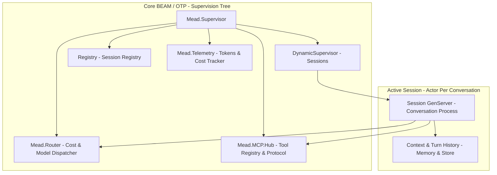
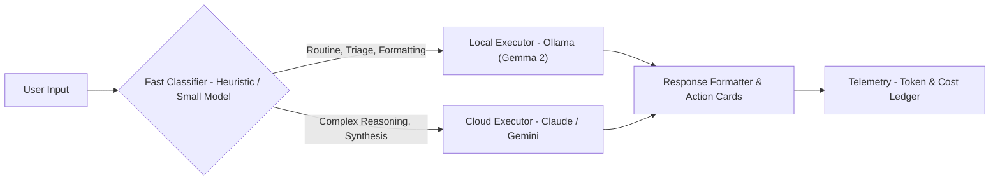

# mead Architecture Specification

**Component:** Core BEAM/OTP Runtime & Smart Router  
**Ecosystem Role:** High-concurrency engine powering AI assistant sessions  

---

## 1. High-Level Supervision Tree

### Component Details
1. **`Mead.Supervisor`:** The application root supervisor. Enforces a `rest_for_one` strategy for foundational infrastructure.
2. **`Mead.Session.Pool` (Sessions):** A `DynamicSupervisor` that starts one `Mead.Session.Supervisor` per active conversation. Each of those supervises that conversation's `Mead.Session.History` and `Mead.Session.Server`.
3. **`Registry`:** Fast in-memory process registry mapping conversation UUIDs to runtime PIDs for microsecond WebSocket routing.
4. **`Mead.Router`:** Analyzes incoming prompt characteristics and decides routing destinations (local Ollama vs. cloud models) based on latency, cost, and complexity.
5. **`Mead.MCP.Hub`:** Aggregates registered tool definitions, manages execution permissions, and translates JSON-RPC MCP messages.
6. **`Mead.Telemetry`:** Real-time token consumption ledger emitting alerts as spend thresholds approach limits.

Implemented so far: the registry, the turn supervisor, and the session pool. `Mead.Router`, `Mead.MCP.Hub`, and `Mead.Telemetry` are specified here and arrive in later slices.

---

## 2. Hybrid Model Scheduler Flow

* **Local Executor:** Handles zero-cost tasks with full privacy (command parsing, email categorization, status checks).
* **Cloud Executor:** Handles complex multi-step reasoning, ambiguous disambiguation, and creative synthesis.
* **Turn Handler:** Packages raw model outputs into streaming Markdown text paired with structured `ActionCard` JSON specifications for client consumption.

---

## 3. Session Internals

Each conversation is a `Mead.Session.Supervisor` started by `Mead.Session.Pool`. It supervises two processes with a `rest_for_one` strategy: `Mead.Session.History`, an agent holding the turns, and `Mead.Session.Server`, which orchestrates them. Because the history starts first, a crashed server restarts with the same session id and the same history, and a turn that was running is marked `interrupted`. A server that crashes more than three times in five seconds takes its whole pair down and that conversation is gone; neighbouring conversations are never affected.

A turn runs in a task under `Mead.TurnSupervisor`, linked to the server, which traps exits. A handler that raises, exits, returns garbage, or exceeds the turn timeout fails only that turn (`failed` or `timeout`), and a server death takes its running task with it. The full design is in `docs/superpowers/specs/2026-10-17-session-skeleton-design.md`.
